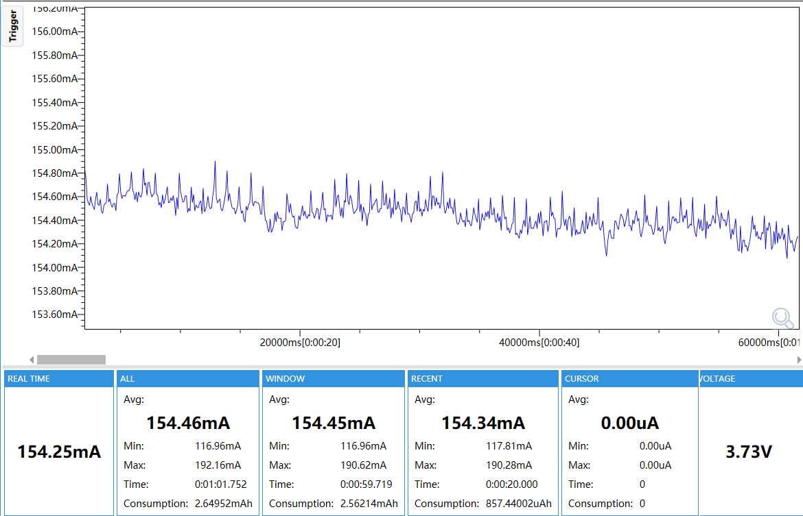
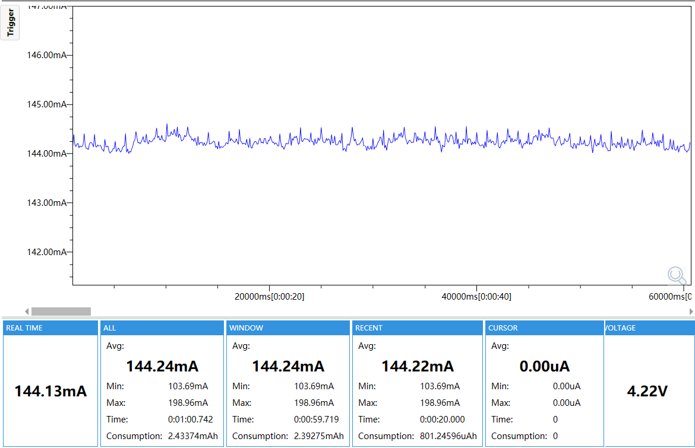

# Display-Only Test

## Purpose

This firmware measures the AMOLED display load independently from the other board peripherals.

## Enabled Modules

- M5PM1 power manager
- M5IOE1 display-control path
- M5GFX AMOLED display driver
- Shared board and test support

## Module Configuration

| Module | Configuration |
|---|---|
| M5PM1 | I2C address `0x6E`, 100 kHz; L1 rail, status LED and external 5 V output disabled |
| M5IOE1 | I2C address `0x4F`, 100 kHz, idle sleep disabled; motor, audio, speaker, touch reset and mux outputs disabled |
| AMOLED | 100% brightness; one full-screen white frame; no refresh after `TEST_READY`; 80 MHz QSPI panel path |
| CPU and memory | 240 MHz CPU; OPI PSRAM enabled |
| Disabled modules | Touch, RTC, IMU, Wi-Fi, audio, motor and external 5 V output |

## Runtime Mode

The firmware enables the display at 100% brightness and renders a white frame. CPU frequency is fixed at 240 MHz. The L1 power domain, touch controller, RTC, IMU, Wi-Fi, audio, motor and external 5 V output are disabled. The static display state is held after `TEST_READY` without later I2C activity.

## Power

The reported current is the `WINDOW Avg` from the selected capture.

- 3.7 V: 154.45 mA
- 4.2 V: 144.24 mA




## Configuration

ESP32-S3, 16 MB Flash, OPI PSRAM at 80 MHz, 240 MHz CPU, 100 kHz I2C, `test_id=display-only`, `config_id=display-only`.

## Build and Flash

Use ESP-IDF 5.5.5:

```bash
idf.py set-target esp32s3
idf.py build
idf.py -p <PORT> flash
idf.py -p <PORT> monitor
```

Use the monitor only for Stage A. Disconnect Type-C before Stage B power measurement.

## Expected Validation

Confirm `TEST_START`, `BOARD_OK PM1=1 IOE1=1 DISPLAY=100 WHITE=1` and `TEST_READY`. No periodic diagnostic logging is expected after readiness.
