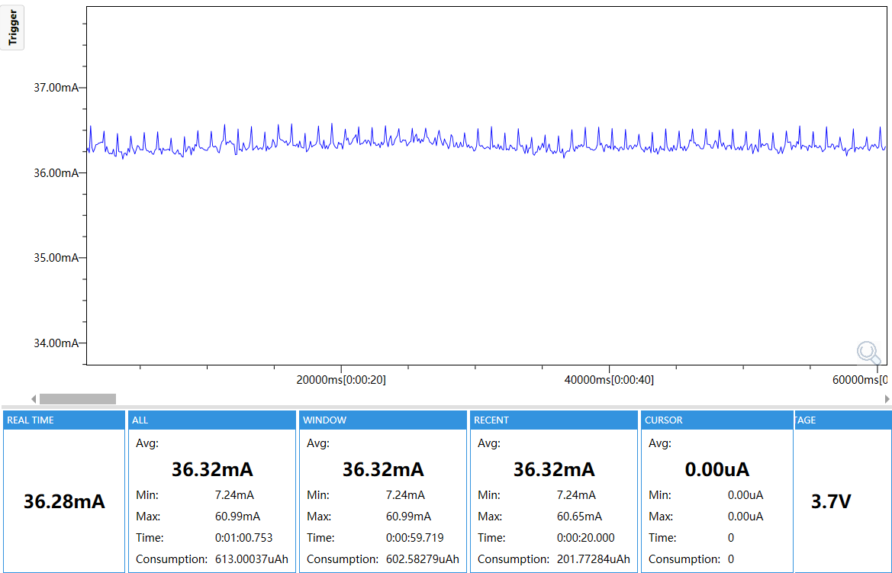
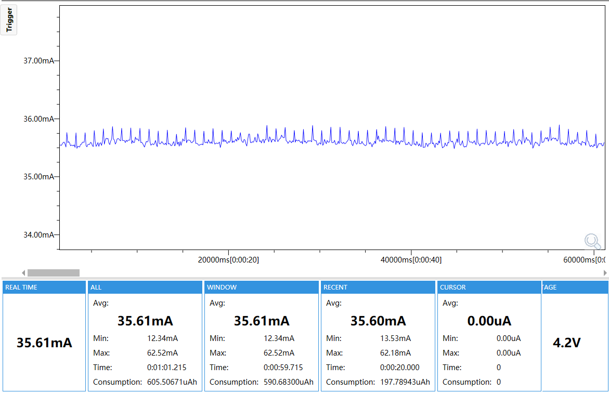

# IMU Sampling Test

## Purpose

This firmware measures continuous BMI270 sampling while other high-level loads are disabled.

## Enabled Modules

- M5PM1 power manager
- M5IOE1 board control
- BMI270 IMU
- Shared board and test support

## Module Configuration

| Module | Configuration |
|---|---|
| BMI270 API | Context mode with magnetometer/AUX |
| Accelerometer | +/-4 g, 200 Hz |
| Gyroscope | +/-1000 dps, 200 Hz |
| Enabled sensors | Accel, Gyro and AUX |
| Read API | `get_sensor_data()` |
| Call period | 10 ms |
| I2C | Address `0x68`, 100 kHz |

| Supporting module | Configuration |
|---|---|
| M5PM1 | L1 rail enabled; status LED and external 5 V output disabled |
| M5IOE1 | 100 kHz; motor/PWM, audio, speaker, display, touch and mux loads disabled |
| CPU | Fixed at 240 MHz |

## Runtime Mode

The firmware initializes the fixed reference IMU profile, verifies the sensor configuration and samples the IMU every 10 ms. Display, touch, Wi-Fi, audio, motor and external 5 V output are disabled.

## Profile

This test has one fixed `reference` profile: Context mode, magnetometer enabled,
accelerometer and gyroscope at 200 Hz, accelerometer +/-4 g and gyroscope
+/-1000 dps. It uses `test_id=imu-sampling`, `config_id=imu-sampling` and
100 kHz I2C. There is no optional `low_power` profile.

## Power

The reported current is the `WINDOW Avg` from the selected capture.

- 3.7 V: 36.32 mA
- 4.2 V: 35.61 mA




## Configuration

ESP32-S3, 16 MB Flash, OPI PSRAM at 80 MHz, 240 MHz CPU, 100 kHz I2C, `test_id=imu-sampling`, `config_id=imu-sampling`.

## Build and Flash

Use ESP-IDF 5.5.5:

```bash
idf.py set-target esp32s3
idf.py build
idf.py -p <PORT> flash
idf.py -p <PORT> monitor
```

Confirm `TEST_START`, `BOARD_OK`, `PROFILE`, `TEST_READY` and stable runtime sampling. Disconnect Type-C before Stage B measurement.
