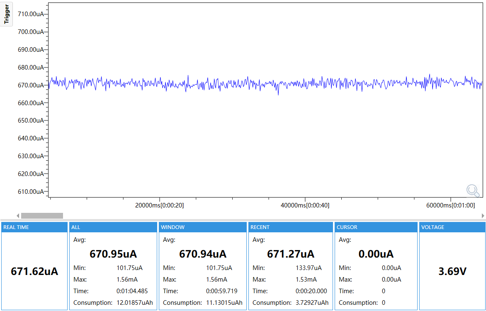
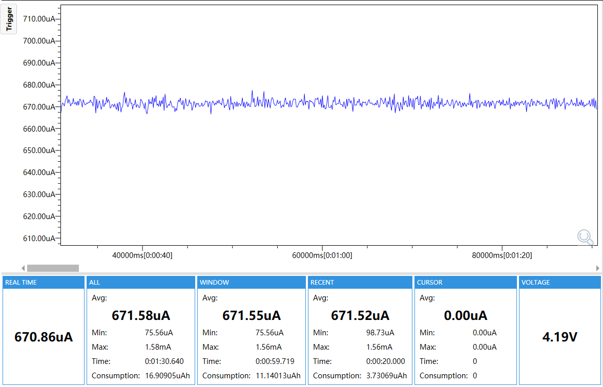
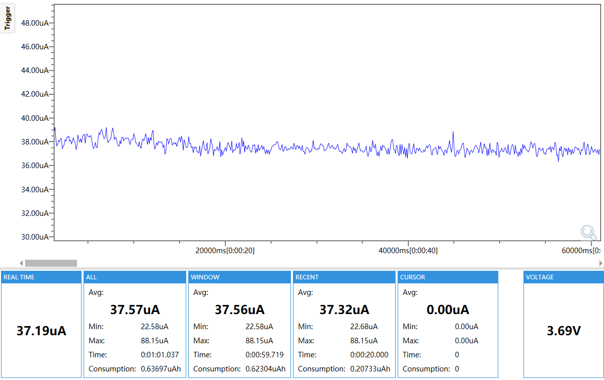
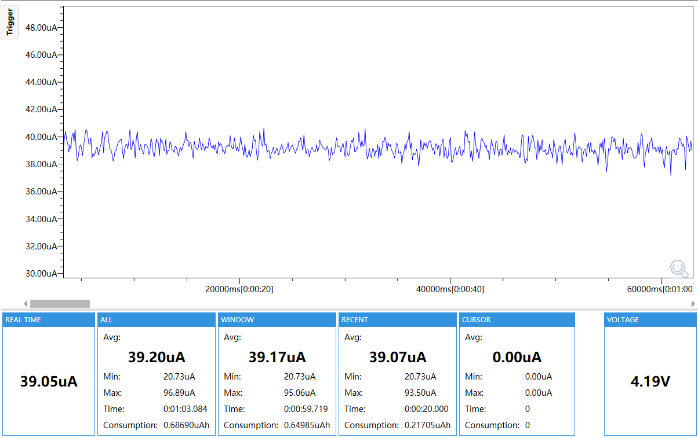

# IMU Wake L1 Test

## Purpose

This firmware validates BMI270 Any-motion wake through the PM1 GPIO0 path while the board remains in L1 standby.

## Enabled Modules

- M5PM1 power manager
- RX8130 RTC for false-trigger rejection and status clearing
- BMI270 IMU Any-motion engine
- PM1 GPIO0 wake path
- Shared wake and test support

## Module Configuration

| Module | Configuration |
|---|---|
| M5PM1 | I2C address `0x6E`, 100 kHz; LDO hold enabled; GPIO0 configured as pull-up input with falling-edge wake; GPIO4 wake disabled |
| BMI270 | I2C address `0x68`, 100 kHz, Base API; Any-motion threshold `30`, duration `10`; INT1 active-high, push-pull and non-latched |
| Reference profile | Accelerometer +/-2 g at 100 Hz, gyroscope +/-2000 dps at 100 Hz; Accel, Gyro, Wrist-wear and Any-motion enabled |
| Low-power profile | Accelerometer +/-2 g at 50 Hz in power-optimized AVG1 mode; Accel and Any-motion enabled; gyroscope and wrist-wear disabled |
| RX8130 | I2C address `0x32`, 100 kHz; alarm, timer and update interrupts disabled for false-trigger rejection |
| Wake path | BMI270 INT1 -> PM1 GPIO0 -> PM1 L1 wake |
| Preparation | 3-second delay after `TEST_READY` before L1 entry |

## Runtime Mode

The firmware captures retained RTC and IMU status, clears stale events, disables RTC interrupts, configures BMI270 INT1 and PM1 GPIO0, reports readiness, waits three seconds, and enters L1 standby. After motion wake it checks PM1 and BMI270 evidence, rejects RTC false triggers, clears the captured status and emits a final result.

## Profiles

Select the profile with `M5SW_IMU_WAKE_L1_REFERENCE_PROFILE` near the top of `main/main.cpp`:

- `1`, `reference`: accelerometer, gyroscope, wrist-wear and Any-motion features enabled; intended to reproduce the reference load of approximately 700 uA.
- `0`, `low_power`: accelerometer at the Any-motion feature rate of 50 Hz in power-optimized AVG1 mode; only Accel and Any-motion are enabled, while gyroscope and wrist-wear are disabled.

Both profiles keep `test_id=imu-wake-l1` and `config_id=imu-wake-l1`.

## Power

The reported current is the `WINDOW Avg` from the selected capture for each profile.

| Profile | 3.7 V | 4.2 V |
|---|---:|---:|
| Reference | 670.94 uA | 671.55 uA |
| Low power | 37.56 uA | 39.17 uA |






## Configuration

ESP32-S3, 16 MB Flash, OPI PSRAM at 80 MHz, 240 MHz CPU and 100 kHz I2C. Use ESP-IDF 5.5.5:

## Build and Flash

```bash
idf.py set-target esp32s3
idf.py build
idf.py -p <PORT> flash
idf.py -p <PORT> monitor
```

Confirm `TEST_START`, `BOARD_OK`, `WAKE_ARMED`, `TEST_READY`, `WAKE_CAPTURE`, `WAKE_CLEAR_OK` and `TEST_PASS`. Disconnect Type-C before formal Stage B measurement.
