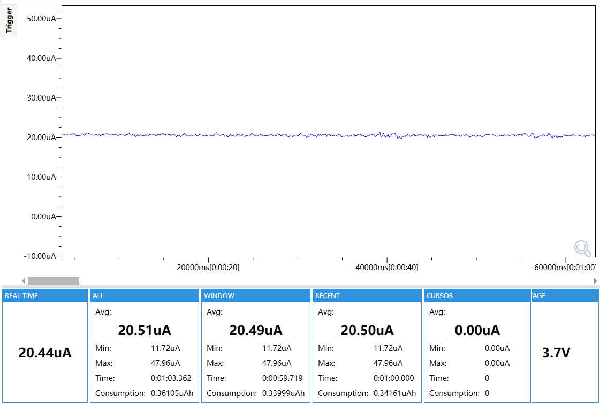
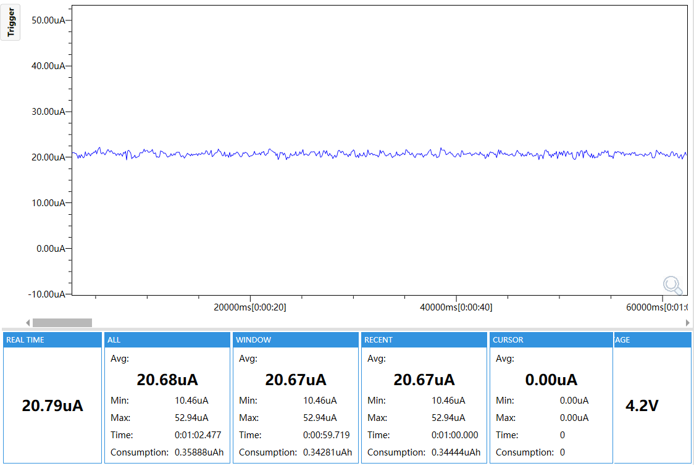

# L1 Standby Test

## Purpose

This firmware measures the M5StopWatch L1 standby state with the RTC and IMU power path retained.

## Enabled Modules

- M5PM1 power manager
- RX8130 RTC
- BMI270 IMU
- Shared M5StopWatch board support
- Test logging and status support

No RTC alarm, RTC timer or IMU motion wake source is enabled in this baseline test. M5IOE1, display, touch, Wi-Fi, audio and motor loads remain disabled.

## Module Configuration

| Module | Configuration |
|---|---|
| M5PM1 | I2C address `0x6E`, 100 kHz; charger and boost disabled; LDO hold enabled; PM1 shutdown command used for L1 entry |
| RX8130 | I2C address `0x32`, 100 kHz; alarm, timer and update interrupts disabled |
| BMI270 | I2C address `0x68`, 100 kHz; Base API initialized; Any-motion and INT1 disabled |
| Wake sources | None |
| Preparation | 3-second delay after `TEST_READY` before L1 entry |

## Runtime Mode

The firmware initializes PM1, RX8130 and BMI270, disables their wake sources, reports board readiness, waits three seconds, and enters PM1 L1 standby. `TEST_READY` is the last expected serial message before the console path is removed.

## Power

The reported current is the `WINDOW Avg` from the selected representative capture.

- 3.7 V: 20.49 uA
- 4.2 V: 20.67 uA




## Configuration

| Setting | Value |
|---|---|
| Target | ESP32-S3 |
| Flash | 16 MB |
| PSRAM | OPI, 80 MHz |
| CPU | 240 MHz |
| I2C | 100 kHz |
| Test ID | `l1-standby` |
| Config ID | `l1-standby` |

## Build and Flash

Use ESP-IDF 5.5.5 from this directory:

```bash
idf.py set-target esp32s3
idf.py build
idf.py -p <PORT> flash
idf.py -p <PORT> monitor
```

Use the monitor only during Stage A. Disconnect Type-C and stop monitoring before Stage B power measurement. Generated build files are not fixed configuration.

## Expected Validation

Confirm `TEST_START`, `BOARD_OK PM1=1 RTC=1 IMU=1` and `TEST_READY`. No periodic diagnostic logging is expected after `TEST_READY`.
