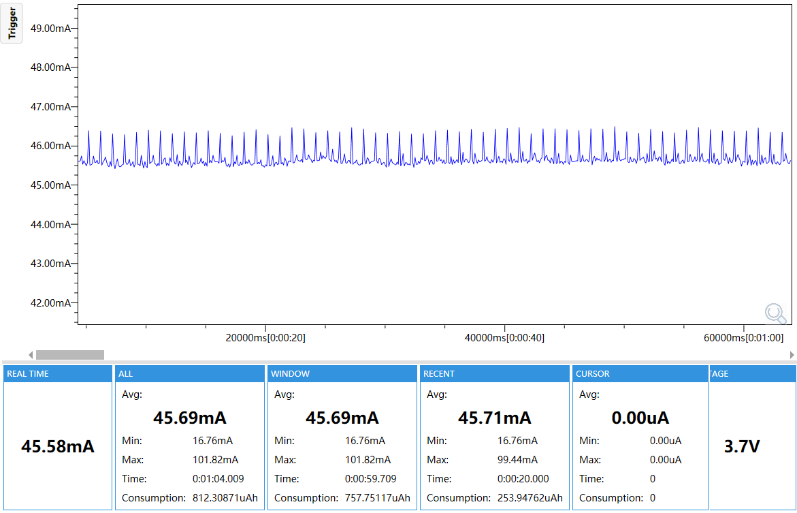
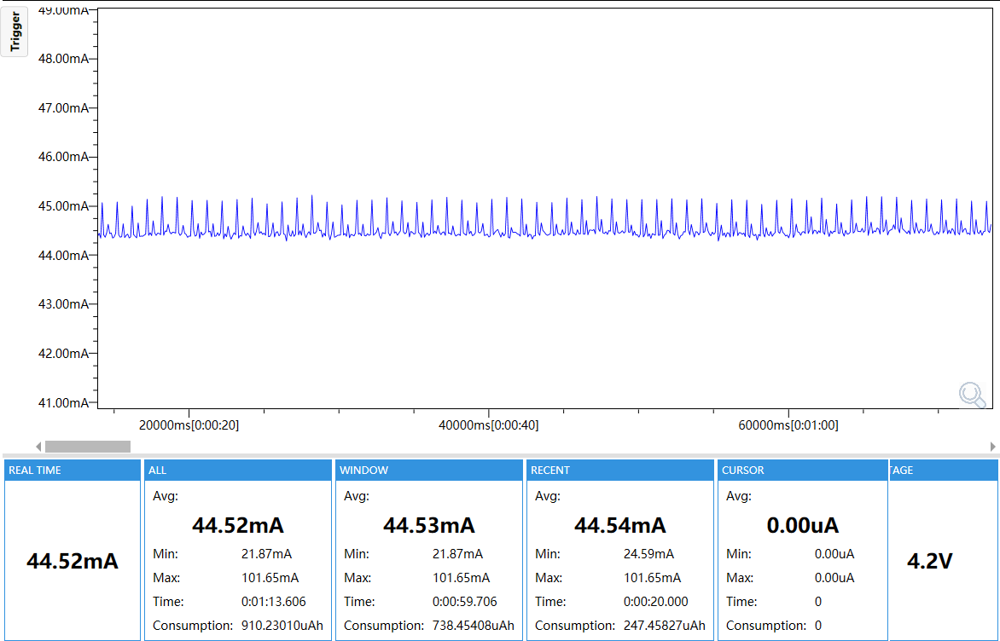

# Normal Active Test

## Purpose

This firmware measures the normal active M5StopWatch load with the primary user-interface and sensing peripherals enabled.

## Enabled Modules

- M5PM1 and M5IOE1 power control
- AMOLED display
- Touch controller
- Two hardware buttons
- RX8130 RTC
- BMI270 IMU
- Shared board and test support

## Module Configuration

| Module | Configuration |
|---|---|
| M5PM1 | I2C address `0x6E`, 100 kHz; charger and LDO enabled; LDO hold enabled; status LED and external 5 V output disabled |
| M5IOE1 | I2C address `0x4F`, 100 kHz, idle sleep disabled; motor `0%`; audio rail and speaker PA disabled |
| AMOLED | 50% brightness; 1 Hz stopwatch-frame refresh; 80 MHz QSPI panel path |
| CST820 touch | I2C address `0x15`, 100 kHz; reset low `10 ms`, ready delay `50 ms`; GPIO13 pull-up input, interrupt disabled |
| Buttons | GPIO1 and GPIO2 pull-up inputs; interrupts disabled |
| RX8130 | I2C address `0x32`, 100 kHz; alarm, timer and update interrupts disabled |
| BMI270 | I2C address `0x68`, 100 kHz; Base API initialized; Any-motion wake not armed |
| CPU and memory | 240 MHz CPU; OPI PSRAM required |

## Runtime Mode

The L1 power domain remains enabled. The display runs at 1 Hz and 50% brightness. Touch, buttons, RTC and IMU remain active. Wi-Fi, audio, motor and external 5 V output are disabled. The firmware performs the configured active workload continuously after `TEST_READY`.

## Power

The reported current is the `WINDOW Avg` from the selected capture.

- 3.7 V: 45.69 mA
- 4.2 V: 44.53 mA




## Configuration

ESP32-S3, 16 MB Flash, OPI PSRAM at 80 MHz, 240 MHz CPU, 100 kHz I2C, `test_id=normal-active`, `config_id=normal-active`.

## Build and Flash

Use ESP-IDF 5.5.5:

```bash
idf.py set-target esp32s3
idf.py build
idf.py -p <PORT> flash
idf.py -p <PORT> monitor
```

Use serial monitoring for Stage A only. Disconnect Type-C and stop monitoring before Stage B measurement.

## Expected Validation

Confirm `TEST_START`, `BOARD_OK PM1=1 IOE1=1 L1=on DISPLAY=50 TP=1 BUTTON=2 RTC=1 IMU=1` and `TEST_READY`. Runtime failures must report `TEST_FAIL` and converge loads to a safe state.
