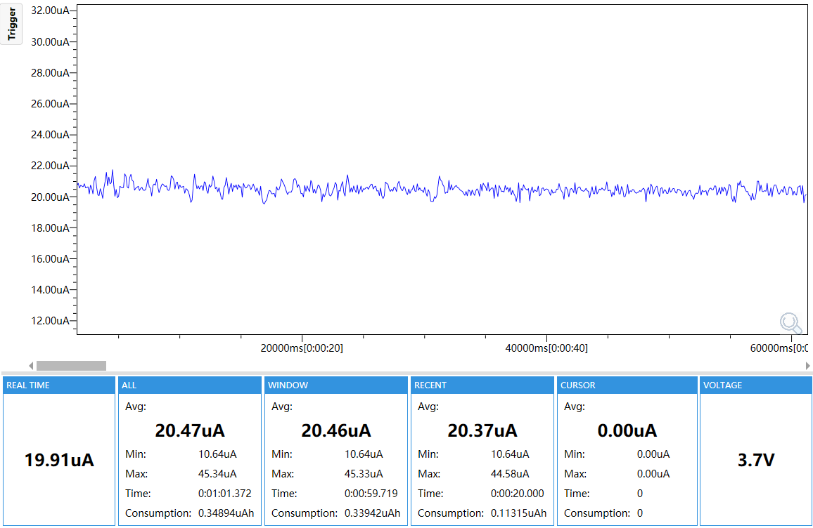
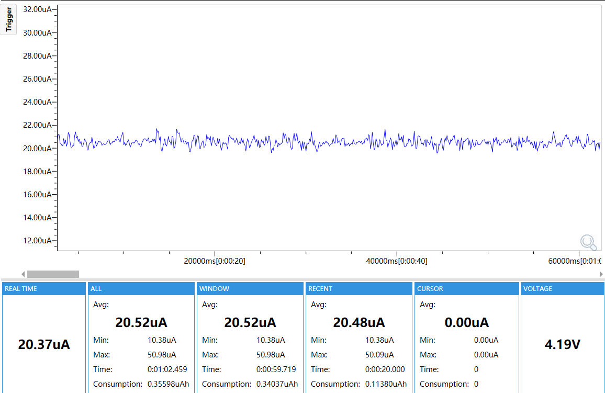

# RTC Timer Wake L1 Test

## Purpose

This firmware validates RX8130 countdown-timer wake while the M5StopWatch remains in L1 standby.

## Enabled Modules

- M5PM1 power manager
- RX8130 countdown timer
- BMI270 IMU for non-target wake rejection
- PM1 GPIO0 wake path
- Shared wake and test support

## Module Configuration

| Module | Configuration |
|---|---|
| M5PM1 | I2C address `0x6E`, 100 kHz; LDO hold enabled; GPIO0 pull-up input with falling-edge wake; GPIO4 wake disabled |
| RX8130 | I2C address `0x32`, 100 kHz; one-shot countdown timer `120 s`, 1 Hz timer source |
| BMI270 | I2C address `0x68`, 100 kHz; Any-motion disabled; status checked only to reject false triggers |
| Wake path | RX8130 IRQ -> PM1 GPIO0 -> PM1 L1 wake |
| Acceptance | RTC timer flag and PM1 GPIO0 evidence must agree; RTC alarm and IMU Any-motion must be false |

## Runtime Mode

The firmware prepares L1, configures the RX8130 one-shot timer for 120 seconds, disables unrelated wake sources, reports readiness and enters L1 standby. After wake it verifies the RTC timer event, clears the captured flags and emits a final result.

## Power

The reported current is the `WINDOW Avg` from the selected capture.

- 3.7 V: 20.46 uA
- 4.2 V: 20.52 uA




## Configuration

ESP32-S3, 16 MB Flash, OPI PSRAM at 80 MHz, 240 MHz CPU, 100 kHz I2C, `test_id=rtc-time-wake-l1`, `config_id=rtc-time-wake-l1`.

## Build and Flash

Use ESP-IDF 5.5.5:

```bash
idf.py set-target esp32s3
idf.py build
idf.py -p <PORT> flash
idf.py -p <PORT> monitor
```

Confirm `RTC_CONFIG_OK`, `BOARD_OK`, `WAKE_ARMED`, `TEST_READY`, `WAKE_CAPTURE`, `WAKE_CLEAR_OK` and `TEST_PASS`. Disconnect Type-C before formal power measurement.
