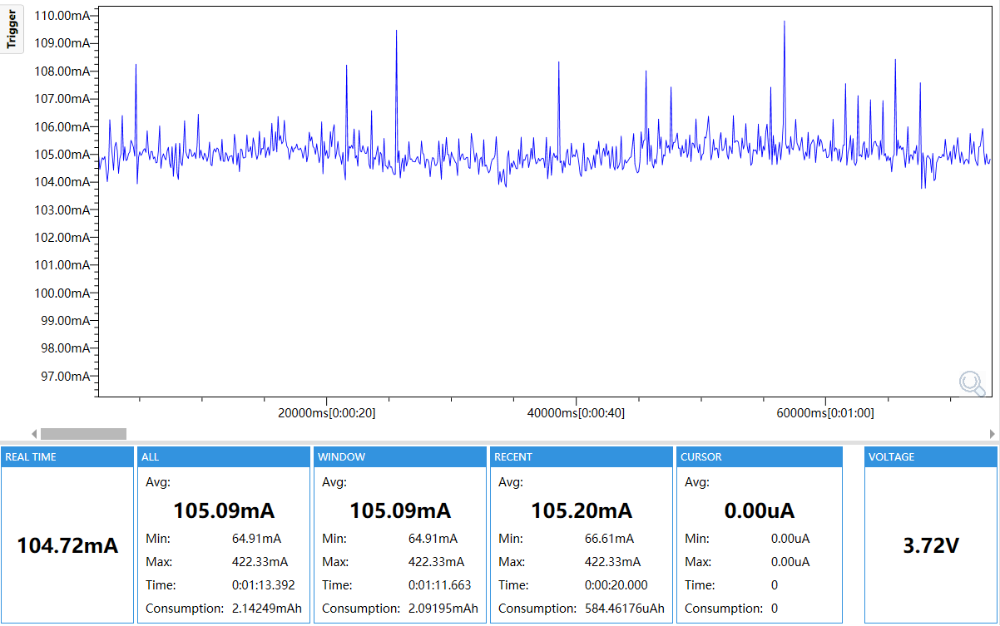
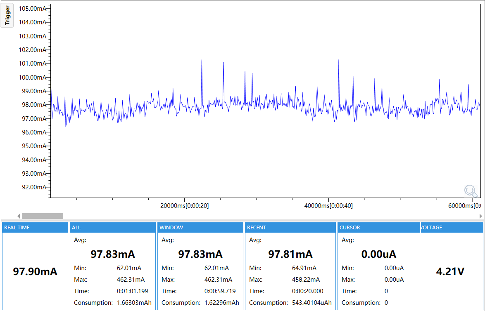

# Wi-Fi Periodic Traffic Test

## Purpose

This firmware measures a connected Wi-Fi station with controlled periodic ICMP traffic.

## Enabled Modules

- M5PM1 and M5IOE1 power control
- ESP32-S3 Wi-Fi station
- ICMP periodic traffic path
- Network interface, event loop and NVS support
- Shared board, power and test support

## Module Configuration

| Module | Configuration |
|---|---|
| Wi-Fi mode | ESP32-S3 station mode, connected to one controlled AP |
| Power save | `WIFI_PS_NONE` |
| Connect timeout | `15000 ms` |
| Traffic | ICMP Echo, one packet every `1000 ms`, `64-byte` payload, `500 ms` timeout |
| Preflight | `10` attempts; minimum success rate `90%` |
| Runtime logging | No per-packet log after `TEST_READY`; non-timeout runtime errors fail the test |
| Test access point | Same controlled AP used by all three Wi-Fi tests |
| Test AP channel | Channel `1` in the supplied connection capture |
| Credentials | Build-time `CONFIG_M5SW_WIFI_SSID` and `CONFIG_M5SW_WIFI_PASSWORD` |
| Traffic target | Build-time `CONFIG_M5SW_WIFI_TARGET_IPV4` |
| AP fields to record | Beacon interval and DTIM period for the controlled access point |
| Reference observation | One reference run recorded RSSI `-41 dBm` and DHCP IPv4 `192.168.0.106`; actual values vary with the access point and test run |
| Per-run fields | Actual target, channel, RSSI, DHCP IPv4 address and preflight result logged before measurement |
| Power baseline | L2-active; L1 retained; display off, buttons isolated, touch asleep, IMU asleep, RTC retained, audio/motor/external 5 V off |
| I2C | PM1 and M5IOE1 at 100 kHz |

## Runtime Mode

The firmware prepares the L2-active baseline, connects with `WIFI_PS_NONE`, runs a ten-packet preflight, and then sends one 64-byte ICMP packet every second. Each packet has a 500 ms timeout. The preflight must achieve at least 90% replies before `TEST_READY`; periodic traffic continues without per-packet logs afterward.

## Network Configuration

Run `idf.py menuconfig`, press `/`, search for `M5SW_WIFI_SSID`, and press `Enter` to jump to the Wi-Fi configuration menu. Set `Controlled test AP SSID`, `Controlled test AP password`, and `Periodic ICMP target IPv4 address`. The target must be a fixed host on the same LAN that responds to ICMP Echo requests. Use the same controlled AP for all three Wi-Fi tests. Record the target, AP channel, RSSI, beacon interval and DTIM period for each run.

## Power

The reported current is the `WINDOW Avg` from the selected capture.

- 3.7 V: 105.09 mA
- 4.2 V: 97.83 mA




## Configuration

ESP32-S3, 16 MB Flash, OPI PSRAM at 80 MHz, 240 MHz CPU, 100 kHz I2C, `test_id=wifi-periodic-traffic`, `config_id=wifi-periodic-traffic`.

## Build and Flash

Use ESP-IDF 5.5.5:

```bash
idf.py set-target esp32s3
idf.py build
idf.py -p <PORT> flash
idf.py -p <PORT> monitor
```

Confirm `TEST_START`, `BOARD_OK ... PERIOD_MS=1000 PAYLOAD_BYTES=64`, and `TEST_READY`. Disconnect Type-C before Stage B measurement.
